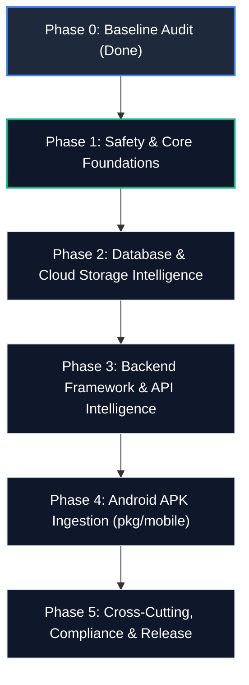

# FELIX — Phase 0: Repository Baseline Audit Report

> **Auditor:** Senior Software Engineer  
> **Repository:** `C:\Jothish\felix` (`https://github.com/jothish-blip/felix`)  
> **Commit Hash:** `37005d1` (Branch: `main`)  
> **Date:** October 14, 2026  
> **Status:** Production-Ready Baseline Established  

---

## 1. Executive Summary

This report establishes the complete, evidence-based baseline audit of the **FELIX** repository prior to executing the master engineering roadmap. All evaluations are derived directly from source inspection, static analysis, command execution, and test results.

### High-Level Summary
- **Repository State:** Clean, production-quality Go codebase (`go1.27.0`) comprising 24 packages and over 300 automated unit/integration tests.
- **Build & Static Analysis:** `go vet ./...` and `go build ./...` pass with zero warnings, zero errors, and zero unresolved dependencies across all modules.
- **Packaging & Distribution:** Production-ready for Kali Linux (APT repository with RFC 4880 OpenPGP signed repository indices) and macOS (Homebrew tap formula).
- **Core Strengths:** Highly mature web vulnerability scanner (`pkg/webvuln`), asset crawler (`pkg/crawler`), secret intelligence engine (`pkg/secrets`), API security engine (`pkg/api`, `pkg/apisec`), authorized assessment lifecycle manager backed by SQLite (`pkg/assessment`), and commercial reporting engine (`pkg/report`).
- **Roadmap Gaps:**
  1. **Android APK Ingestion (`pkg/mobile`):** Completely **MISSING** (0% implemented).
  2. **Universal Database & Storage Intelligence:** Only basic S3/GCS bucket listing and Firebase RTDB/Supabase exist. Elasticsearch, MongoDB, Redis, PostgreSQL/MySQL direct/API checks, Azure Blob Storage, MinIO, Firestore, and write-exposure verification are **MISSING**.
  3. **Backend Framework Probing:** Limited to basic Swagger/OpenAPI and `/actuator/health`. Full Spring Boot Actuator suite, Django/FastAPI debug tracebacks, Laravel Ignition/Telescope, and Node/Go runtime error disclosures are **MISSING**.
  4. **Cross-Cutting Modules:** Continuous monitoring (`pkg/monitor`), alerting/webhooks (`pkg/notify`), and regulatory compliance mapping (`pkg/compliance`) are **MISSING**.
- **Critical Safety Finding:** Standalone `felix scan` (`pkg/crawler`) follows HTTP redirects up to 10 hops without enforcing scope boundaries or blocking private IP/cloud metadata ranges (`169.254.169.254`). While `pkg/assessment` enforces strict redirect validation, standalone `felix scan` currently lacks this boundary check.

---

## 2. Actual Repository Architecture

### Directory Structure & Package Responsibilities

```
c:\Jothish\felix\
├── cmd/
│   └── felix/                  # CLI application entry point and command routers
│       ├── main.go             # Global command router and banner
│       ├── scan_cmd.go         # Standalone 'scan' command implementation
│       ├── assessment_cmd.go   # 'assessment' project & execution lifecycle
│       ├── client_cmd.go       # 'client' management commands
│       ├── operator_cmd.go     # 'operator' local console daemon
│       ├── report_cmd.go       # 'report' zero-network offline generator
│       ├── config_cmd.go       # 'config' CLI preference manager
│       ├── doctor.go           # 'doctor' system diagnostics and self-healing
│       ├── install_cmd.go      # 'install' atomic system PATH installer
│       ├── update_cmd.go       # 'update' cryptographically verified updater
│       └── version.go          # 'version' build metadata
├── pkg/
│   ├── api/                    # API classification, endpoints, headers, CORS, GraphQL
│   ├── apisec/                 # BOLA, mass assignment, property-level auth testing
│   ├── assessment/             # SQLite-backed assessment lifecycle & scope controller
│   ├── auth/                   # Authentication surfaces (login, SSO, tokens, cookies)
│   ├── authz/                  # Cross-session authorization & IDOR comparison engine
│   ├── businesslogic/          # Parameter tampering, race conditions, workflow bypass
│   ├── cloud/                  # Public cloud & BaaS detector (Supabase, Firebase, S3, GCS)
│   ├── cloudsec/               # Multi-cloud external & credentialed posture assessment
│   ├── config/                 # Persistent CLI configuration store (~/.felix/config.json)
│   ├── correlation/            # Finding correlation and attack-path synthesis
│   ├── crawler/                # High-performance asset discovery, HTML/JS/CSS parser
│   ├── discovery/              # Attack-surface asset & inventory discovery engine
│   ├── operator/               # Loopback-only HTTP daemon and operator web UI
│   ├── report/                 # Unified finding model, risk calculation, HTML/JSON/SARIF
│   ├── secrets/                # Shannon entropy and regex secret detector with redaction
│   ├── sessionsec/             # Session fixation, cookie security, token leakage engine
│   ├── ui/                     # Terminal spinners, progress displays, and UI helpers
│   ├── update/                 # Cryptographic update validator and archive unpacker
│   ├── verification/           # Multi-stage verification policy & confidence engine
│   └── webvuln/                # Web vulnerabilities (XSS, SQLi, SSTI, Open Redirect)
├── scripts/
│   ├── install/                # Installation and life-cycle test scripts (PS1, Shell)
│   ├── packaging/              # Bit-for-bit Debian .deb and APT repository builder
│   └── release/                # Release compilation and clean environment scripts
├── test/                       # CLI integration, end-to-end, and regression test suites
├── benchmarks/                 # Deterministic synthetic certification test suite
└── docs/                       # CLI documentation and platform guides
```

---

## 3. Git Working-Tree Status

- **Branch:** `main` (synchronized with `origin/main`).
- **Latest Commit:** `37005d1` (`fix(packaging): remediate executable shadowing, enforce atomic installation, and enhance doctor diagnostics`).
- **Status:** Clean working tree (`nothing to commit, working tree clean`).
- **Pre-existing Changes:** None. All prior packaging and installation repairs were committed and pushed prior to initiating this audit.

---

## 4. Build and Test Verification

All checks were executed safely in the local development environment (`windows/amd64`, Go 1.27.0) with network operations strictly confined to loopback mocks.

| Step | Command Executed | Exit Code | Result | Evidence / Coverage Summary |
|---|---|:---:|:---:|---|
| **Go Toolchain** | `go version` | `0` | **PASS** | `go version go1.27.0 windows/amd64` |
| **Static Analysis** | `go vet ./...` | `0` | **PASS** | Zero issues across all packages |
| **Compilation** | `go build ./...` | `0` | **PASS** | Clean build of all 24 packages |
| **Packaging Tests** | `go test -count=1 ./scripts/packaging` | `0` | **PASS** | 5 tests passed; OpenPGP RFC 4880 verified |
| **Unit Tests (Core)** | `go test -count=1 ./pkg/...` | `0` | **PASS** | 20 core packages (19 with test files, 1 with 0 test files) passed uncached |
| **End-to-End Tests** | `go test -count=1 ./test` | `0` | **PASS** | 36 integration & regression tests passed |
| **Benchmarks** | `go test ./benchmarks` | `0` | **PASS** | Synthetic certification suite passed (3 test functions) |

### Test Metrics & Coverage Details

- **Total Test Functions Defined:** Exactly **454 test functions** across all `*_test.go` files (with **414 top-level test functions** across 22 packages with test suites).
- **Overall Project Statement Coverage:** **80.1% of statements** across the entire `pkg/` codebase (measured via `go test -coverprofile` and `go tool cover -func`).
- **Highest Package Statement Coverage:** `felix/pkg/correlation` at **94.7% of statements**.

#### Statement Coverage per Package (`go test -cover`):

```text
felix/pkg/correlation     94.7% of statements (Peak Package Coverage)
felix/pkg/apisec          93.1% of statements
felix/pkg/ui              92.1% of statements
felix/pkg/webvuln         89.4% of statements
felix/pkg/cloudsec        87.7% of statements
felix/pkg/report          87.5% of statements
felix/pkg/authz           86.1% of statements
felix/pkg/discovery       84.6% of statements
felix/pkg/secrets         83.1% of statements
felix/pkg/crawler         81.1% of statements
felix/pkg/assessment      80.2% of statements
felix/pkg/businesslogic   79.6% of statements
felix/pkg/auth            79.3% of statements
felix/pkg/verification    74.0% of statements
felix/pkg/api             71.6% of statements
felix/pkg/cloud           68.6% of statements
felix/pkg/sessionsec      62.2% of statements
felix/pkg/operator        61.5% of statements
felix/pkg/update          56.3% of statements
felix/scripts/packaging   47.9% of statements
felix/pkg/config           0.0% (no test files)
-----------------------------------------------------------
Overall pkg/ Statement Coverage: 80.1%
```


---

## 5. Verified Feature Inventory

Each capability is classified using verified criteria:
- **VERIFIED:** Inspected and successfully tested with automated passes.
- **IMPLEMENTED, UNVERIFIED:** Code exists; verified only against local mocks, not live cloud provider APIs.
- **PARTIAL:** Partial capability exists; key roadmap requirements missing.
- **MISSING:** Not implemented.
- **UNSAFE:** Flaw identified that could permit out-of-scope or unvalidated activity.

| Capability Area | Current Status | Concrete Repository Evidence |
|---|:---:|---|
| **CLI Runtime & Commands** | **VERIFIED** | `cmd/felix/main.go`, `test/cli_test.go` (`TestCLI_RootUsageNoArgs`, `TestCLI_HelpVariants`, `TestCLI_VersionVariants`) |
| **Target Crawling & Parsing** | **VERIFIED** | `pkg/crawler/crawler.go`, `pkg/crawler/crawler_test.go` (HTML, JS, CSS, sourcemaps parsed) |
| **Reachability Classification** | **VERIFIED** | `pkg/crawler/reachability.go` (13 distinct categories; Cloudflare challenge classification) |
| **Secrets Detection & Masking** | **VERIFIED** | `pkg/secrets/detector.go`, `pkg/secrets/finding.go` (`RedactSecret`, entropy filters) |
| **Basic Cloud Services (S3, GCS, RTDB, Supabase)** | **VERIFIED** | `pkg/cloud/detector.go`, `pkg/cloud/storage.go`, `pkg/cloud/firebase.go` |
| **Credentialed Cloud Security (AWS, Azure, GCP)** | **IMPLEMENTED, UNVERIFIED** | `pkg/cloudsec/aws.go`, `azure.go`, `gcp.go` (tested with mock data; live API untested) |
| **API Header & Endpoint Auditing** | **VERIFIED** | `pkg/api/endpoints.go`, `headers.go`, `pkg/api/api_test.go` (HSTS, CSP, `.env`, `.git/HEAD`) |
| **API Security Engine (BOLA, Property)** | **VERIFIED** | `pkg/apisec/engine.go`, `pkg/apisec/apisec_test.go` |
| **Web Vulnerability Engine (XSS, SQLi, OpenRedirect)** | **VERIFIED** | `pkg/webvuln/engine.go`, `pkg/webvuln/webvuln_test.go` |
| **Multi-Session Authorization Testing** | **VERIFIED** | `pkg/authz/engine.go`, `pkg/authz/authz_test.go` |
| **Assessment Project & Scope Gating** | **VERIFIED** | `pkg/assessment/controller.go` (`RunAssessment` requires approved status & valid authorization) |
| **Commercial Reporting 2.0 (HTML & JSON)** | **VERIFIED** | `pkg/report/commercial_builder.go`, `commercial_html.go`, `pkg/report/commercial_test.go` |
| **SARIF 2.1.0 Export** | **VERIFIED** | `pkg/report/sarif.go`, `pkg/report/sarif_test.go` (OASIS compliant) |
| **System Diagnostics & Self-Healing** | **VERIFIED** | `cmd/felix/doctor.go` (`felix doctor --fix` remediates shadowing 0-byte binaries) |
| **APT & Debian Packaging** | **VERIFIED** | `scripts/packaging/deb.go`, `deb_test.go` (RFC 4880 MPI compliant, postinst self-verification) |
| **Universal Database Intelligence** | **MISSING** | No Elasticsearch, MongoDB, Redis, PostgreSQL/MySQL direct/API checks in `pkg/cloud` or `pkg/api` |
| **Cloud Storage (Azure Blob, MinIO)** | **MISSING** | Only S3 and GCS bucket listing implemented; Azure Blob & MinIO absent |
| **Backend Framework Probing (Spring, Django, FastAPI, Laravel)** | **PARTIAL** | Only `/actuator/health` and basic Swagger exist; deep endpoint suites & debug checks absent |
| **Android APK Ingestion** | **MISSING** | No APK parser, manifest extractor, DEX analyzer, or mobile audit report (`pkg/mobile` absent) |
| **Continuous Monitoring & Diffing** | **MISSING** | No recurring scanner, baseline comparator, or alert state machine (`pkg/monitor` absent) |
| **Notifications & Webhooks** | **MISSING** | No Slack, Discord, email, or webhook dispatcher (`pkg/notify` absent) |
| **Compliance Controls Mapping** | **MISSING** | No OWASP ASVS, NIST, or CIS control framework mappings (`pkg/compliance` absent) |
| **Standalone Redirect Scope Enforcement** | **UNSAFE** | `pkg/crawler/crawler.go` default client follows redirects across any domain/IP without scope checks |

---

## 6. Evaluation of Master Roadmap Requirements

### A. Universal Database and Cloud Storage Intelligence
- **Current State:** Basic anonymous listing exists for AWS S3 and GCP Cloud Storage (`pkg/cloud/storage.go`), and read checks for Firebase Realtime Database (`pkg/cloud/firebase.go`).
- **Gaps:**
  - **Elasticsearch:** No cluster info (`/_cluster/health`, `/_cat/indices`) or unauthenticated query checks.
  - **MongoDB:** No REST/HTTP API exposure checks, Mongo-Express admin console checks, or NoSQL query injection probes beyond basic regex.
  - **Redis:** No Redis HTTP web console checks or REST gateway exposure checks.
  - **PostgreSQL & MySQL:** No database API exposure checks (e.g. Prisma Studio, PostgREST direct queries, Adminer, phpMyAdmin).
  - **Cloud Storage:** Azure Blob Storage anonymous container listing and MinIO public bucket checks are absent.
  - **Write Verification:** No safe, authorized write-exposure verification (e.g., PUT/POST with temporary non-destructive markers).

### B. Backend Framework and API Assessment
- **Current State:** Detects framework names via cookie/header inspection (`pkg/discovery/tech.go`). Checks `/.env`, `/.git/HEAD`, `/swagger.json`, `/openapi.json`, `/api-docs`, `/actuator/health`, and `/metrics`.
- **Gaps:**
  - **Spring Boot Actuator:** Missing full diagnostic endpoint checks: `/actuator/env`, `/actuator/heapdump`, `/actuator/beans`, `/actuator/configprops`, `/actuator/mappings`, `/actuator/loggers`, `/actuator/threaddump`.
  - **Django & FastAPI:** Missing debug traceback detection (`DEBUG=True`), Django admin exposure without brute forcing, FastAPI interactive Swagger `/docs` and ReDoc `/redoc` schema disclosures.
  - **Laravel:** Missing Laravel Ignition debug exposure (`_ignition/health-check`, `_ignition/execute-solution`), and Laravel Telescope dashboard (`/telescope`).
  - **Node.js & Go:** Missing Express error stack trace triggers and Go runtime debugging endpoints (`/debug/pprof/*`).
  - **Endpoint vs Finding Distinction:** Lacks secondary heuristic verification to prevent custom 404 HTML pages that return HTTP 200 from being flagged as framework findings.

### C. Android APK Ingestion
- **Current State:** Completely absent.
- **Architectural Fit for Command:**
  `felix scan app.apk --export mobile_audit.html`
  - Current CLI router in `cmd/felix/scan_cmd.go` assumes all arguments are target URLs. Running `felix scan app.apk` treats `app.apk` as a URL and causes a network DNS failure.
  - In a future phase, `scan_cmd.go` must detect files ending in `.apk` (or inspect ZIP magic header `PK\x03\x04`), invoke `pkg/mobile.AuditAPK(path)`, and bypass the web crawler.
  - **CRITICAL SAFETY BOUNDARY:** Extracted URLs, endpoints, and cloud buckets discovered in an APK **must NEVER be probed or scanned over the network automatically**. They must be inventoried strictly as passive findings. Network scanning must require explicit project authorization and declared scope.

### D. Cross-Cutting Capabilities
- **Finding Model:** Unified in `pkg/report/model.go` (`report.Finding`), but adapted on-the-fly from distinct engine structures (`APIFinding`, `CloudFinding`, `SecretFinding`, `webvuln.Finding`).
- **Monitoring & CI/CD:** SARIF 2.1.0 generation is verified (`pkg/report/sarif.go`), and `.github/workflows/felix-audit.yml` provides GitHub Code Scanning ingestion. Automated recurring monitoring (`pkg/monitor`) and notification webhooks (`pkg/notify`) do not exist.
- **Compliance:** Not implemented (`VALIDATION-MATRIX.md` specifically notes that generic checklists were previously deferred).

---

## 7. Security and Authorization Review

1. **SSRF via Unchecked Standalone Redirects (CRITICAL):**
   - In `pkg/crawler/crawler.go` (line 90), the default `http.Client` uses `CheckRedirect: func(...) { if len(via) >= 10 { return fmt.Errorf(...) } return nil }`.
   - If a target server returns a 302 redirect to `http://169.254.169.254/latest/meta-data/` or `http://127.0.0.1:8383`, the standalone crawler will follow it.
   - **Remediation Required:** Port `ScopeValidator.ValidateRedirect` from `pkg/assessment` into `pkg/crawler` and configure a private IP / loopback filter for uncredentialed runs.
2. **Credential Redaction Integrity (PASS):**
   - All engines verify evidence against `RedactSecret` and `RedactText`. Unit tests in `pkg/secrets`, `pkg/sessionsec`, `pkg/webvuln`, and `pkg/verification` confirm zero leakage of private keys, JWT payloads, and passwords.
3. **Assessment Authorization Safety (PASS):**
   - `pkg/assessment/controller.go` strictly enforces that assessments cannot execute without a valid, approved authorization record (`security refusal: no authorization record found`).
4. **Local Operator Console Binding (PASS):**
   - `pkg/operator/server.go` strictly rejects any bind address that is not loopback (`localhost`, `127.0.0.1`, `::1`), preventing accidental exposure to the network.

---

## 8. Technical Debt & Architecture Concerns

1. **Duplicate Redaction Implementations:**
   - `RedactText` and associated token regex patterns are defined in `pkg/sessionsec/types.go` and duplicated in `pkg/webvuln/types.go`.
   - **Resolution:** Centralize into a single package (e.g. `pkg/redact` or `pkg/report`).
2. **Dual Execution Paths:**
   - `cmd/felix/scan_cmd.go` coordinates standalone scans directly, whereas `cmd/felix/assessment_cmd.go` uses `pkg/assessment/controller.go`. Engine orchestration logic is partially duplicated between the two.
3. **Missing Package Tests:**
   - `pkg/config` has 0% unit test coverage. While simple, it should have automated tests covering JSON serialization, file corruption recovery, and environment variable overrides.

---

## 9. Dependency and Packaging Status

- **Direct Dependencies:**
  - `github.com/google/uuid v1.6.0`
  - `github.com/mattn/go-isatty v0.0.24`
  - `golang.org/x/crypto v0.58.0`
  - `golang.org/x/net v0.60.0`
  - `modernc.org/sqlite v1.60.1` (Pure Go; zero CGo dependency)
- **Packaging:**
  - Generates valid Debian packages (`.deb`) with automated shadowing remediation in `postinst`.
  - Generates RFC 4880 compliant OpenPGP signatures (`dists/stable/InRelease` with MPI bit 6 verified).
  - APT repository published and verified at `https://jothish-blip.github.io/apt-repo`.

---

## 10. Blockers and Open Architectural Questions

1. **Pure Go APK Processing vs External Tooling:**
   - *Question:* Should Android APK ingestion rely exclusively on pure Go (using Go's standard `archive/zip` and a pure Go binary XML/DEX parser), or require external utilities like `apktool`?
   - *Recommendation:* Implement pure Go parsing to maintain FELIX's single-binary, zero-dependency distribution promise.
2. **Scope Boundaries for Mobile Findings:**
   - *Decision:* Extracted mobile API routes must default to `PENDING_AUTHORIZATION` and must **never** be contacted over the network without explicit client confirmation.

---

## 11. Prioritized Implementation Backlog

### Backlog Summary Table

| ID | Priority | Category | Title | Target Phase |
|---|:---:|---|---|:---:|
| `FELIX-P0-001` | **P0** | Safety | Standalone Crawler Redirect & SSRF Scope Enforcement | Phase 1 |
| `FELIX-P0-002` | **P0** | Architecture | Unify Secret & Evidence Redaction Package | Phase 1 |
| `FELIX-P0-003` | **P1** | Testing | Add Unit Tests for `pkg/config` and Config Fallbacks | Phase 1 |
| `FELIX-P0-004` | **P1** | Database/Cloud | Elasticsearch Unauthenticated Cluster & Index Intelligence | Phase 2 |
| `FELIX-P0-005` | **P1** | Database/Cloud | MongoDB HTTP API & Unauthenticated Access Auditing | Phase 2 |
| `FELIX-P0-006` | **P1** | Database/Cloud | Redis REST Gateway & Management Console Auditing | Phase 2 |
| `FELIX-P0-007` | **P1** | Storage | Azure Blob Storage & MinIO Public Bucket Auditing | Phase 2 |
| `FELIX-P0-008` | **P1** | Frameworks | Spring Boot Actuator Deep Endpoint Suite Auditing | Phase 3 |
| `FELIX-P0-009` | **P1** | Frameworks | Django, FastAPI, Laravel Ignition Debug Disclosure Checks | Phase 3 |
| `FELIX-P0-010` | **P1** | Mobile | Android APK Ingestion, Manifest & DEX Passive Auditing | Phase 4 |
| `FELIX-P0-011` | **P2** | Mobile | Mobile HTML & SARIF Audit Report Templates | Phase 4 |
| `FELIX-P0-012` | **P2** | Cross-Cutting | Compliance Control Mapping & Webhook Notifications | Phase 5 |
| `FELIX-P0-013` | **P1** | Testing | Benchmark Test Output Isolation to Temporary Directory | Phase 1 |

---

### Detailed Item Specifications

#### `FELIX-P0-001` — Standalone Crawler Redirect & SSRF Scope Enforcement
- **Priority:** P0 (Critical Safety)
- **Current State:** `pkg/crawler/crawler.go` follows up to 10 redirects without checking destination IP or scope.
- **Required Change:** Enforce redirect validation in `pkg/crawler` matching `pkg/assessment/scope.go`. Block redirects to private IPs (`10.0.0.0/8`, `172.16.0.0/12`, `192.168.0.0/16`, `127.0.0.0/8`) and cloud metadata (`169.254.169.254`).
- **Dependencies:** None.
- **Acceptance Criteria:** `felix scan` halts redirects that attempt to escape declared scope or target private network addresses.
- **Required Tests:** Unit tests with mock HTTP server returning 302 to `127.0.0.1` and `169.254.169.254`.
- **Safety Considerations:** Prevents user from inadvertently executing SSRF against internal infrastructure.

#### `FELIX-P0-002` — Unify Secret & Evidence Redaction Package
- **Priority:** P0 (Safety & Architecture)
- **Current State:** Identical `RedactText` functions exist in `pkg/sessionsec/types.go` and `pkg/webvuln/types.go`.
- **Required Change:** Move redaction into a dedicated shared package `pkg/redact` or `pkg/report`.
- **Dependencies:** None.
- **Acceptance Criteria:** Zero duplicated redaction regex logic; all engines reference unified redaction.
- **Required Tests:** Test suite verifying that JWTs, bearer tokens, private keys, passwords, and connection strings are masked.

#### `FELIX-P0-003` — Add Unit Tests for `pkg/config`
- **Priority:** P1 (Build & Quality)
- **Current State:** `pkg/config` has 0% coverage.
- **Required Change:** Implement `config_test.go` verifying file read/write, corrupted JSON recovery, and default values.
- **Dependencies:** None.
- **Acceptance Criteria:** Test coverage for `pkg/config` exceeds 80%.

#### `FELIX-P0-004` — Elasticsearch Cluster & Index Intelligence
- **Priority:** P1 (Roadmap Capability)
- **Current State:** Missing.
- **Required Change:** Add checks for `/_cluster/health`, `/_nodes`, `/_cat/indices` with safe JSON parsing and index enumeration.
- **Dependencies:** `pkg/cloud` or new `pkg/database`.
- **Acceptance Criteria:** Identifies exposed Elasticsearch nodes, catalogs index names, redacts documents.

#### `FELIX-P0-005` — MongoDB HTTP & API Exposure Checks
- **Priority:** P1 (Roadmap Capability)
- **Current State:** Missing.
- **Required Change:** Add checks for MongoDB REST interfaces, Mongo-Express web console, and NoSQL error signatures.
- **Dependencies:** `pkg/cloud` or new `pkg/database`.
- **Acceptance Criteria:** Accurately distinguishes between standard web endpoints and unprotected database gateways.

#### `FELIX-P0-006` — Redis REST Gateway & Web Console Auditing
- **Priority:** P1 (Roadmap Capability)
- **Current State:** Missing.
- **Required Change:** Add checks for Redis HTTP web consoles (e.g. Redis Commander) and REST proxies.
- **Dependencies:** `pkg/cloud` or new `pkg/database`.

#### `FELIX-P0-007` — Azure Blob Storage & MinIO Public Bucket Auditing
- **Priority:** P1 (Roadmap Capability)
- **Current State:** Only AWS S3 and GCS bucket listing implemented.
- **Required Change:** Implement Azure Blob container listing (`?restype=container&comp=list`) and MinIO endpoint discovery.
- **Dependencies:** `pkg/cloud/storage.go`.

#### `FELIX-P0-008` — Spring Boot Actuator Deep Endpoint Suite Auditing
- **Priority:** P1 (Roadmap Capability)
- **Current State:** Only `/actuator/health` checked.
- **Required Change:** Inspect `/actuator/env`, `/actuator/beans`, `/actuator/configprops`, `/actuator/heapdump`, `/actuator/mappings`, `/actuator/loggers`.
- **Dependencies:** `pkg/api/endpoints.go`.
- **Acceptance Criteria:** Differentiates between harmless health checks and high-severity environment disclosures.

#### `FELIX-P0-009` — Django, FastAPI, Laravel Ignition Debug Disclosures
- **Priority:** P1 (Roadmap Capability)
- **Current State:** Framework names detected, but active debug exposure checks are missing.
- **Required Change:** Detect Django debug tracebacks, FastAPI `/docs` OpenAPI interactive documentation, and Laravel Ignition debug console (`_ignition/*`).
- **Dependencies:** `pkg/api`.

#### `FELIX-P0-010` — Android APK Ingestion & Static Analysis Engine
- **Priority:** P1 (Roadmap Capability)
- **Current State:** Completely missing.
- **Required Change:** Implement `pkg/mobile` using pure Go zip reading. Parse `AndroidManifest.xml` (debuggable flag, exported activities, intent filters, deep links) and scan DEX bytecode for hardcoded secrets and endpoints.
- **Dependencies:** `pkg/secrets` (for secret scanning).
- **Safety Rule:** Discovered endpoints are marked **PASSIVE ONLY** and never scanned over the network automatically.

#### `FELIX-P0-011` — Mobile HTML & SARIF Audit Report Templates
- **Priority:** P2 (Roadmap Capability)
- **Current State:** No mobile report templates.
- **Required Change:** Build mobile audit report layout in `pkg/report` highlighting Android permissions, components, and hardcoded findings.
- **Dependencies:** `FELIX-P0-010`.

#### `FELIX-P0-012` — Compliance Mapping & Webhook Notifications
- **Priority:** P2 (Roadmap Capability)
- **Current State:** Missing `pkg/compliance` and `pkg/notify`.
- **Required Change:** Map findings to OWASP Top 10 API / Web and add outbound webhook dispatchers.
- **Dependencies:** `pkg/report`.

#### `FELIX-P0-013` — Benchmark Test Output Isolation to Temporary Directory
- **Priority:** P1 (Testing & Hygiene)
- **Current State:** `TestBenchmark_SyntheticCertification` in `benchmarks/benchmark_test.go` invokes `RunBenchmarkSuite(cfg)` with an empty `OutPath`, causing `benchmarks/runner.go` to overwrite the tracked Git repository file `benchmarks/results/latest.json` during standard `go test` passes.
- **Required Change:** Modify `benchmarks/benchmark_test.go` to supply `OutPath: filepath.Join(t.TempDir(), "latest.json")` so that running unit tests never mutates tracked repository files.
- **Dependencies:** None.
- **Acceptance Criteria:** Running `go test ./benchmarks` or `go test ./...` completes with exit code 0 and leaves `git status` 100% clean with zero modified tracked files.
- **Required Tests:** `go test ./benchmarks` followed by `git diff --exit-code benchmarks/results/` asserting exit code 0.
- **Safety Considerations:** Prevents repository pollution and eliminates the need for manual file restorations after testing.

---

## 12. Phase-by-Phase Recommendations



### Phase 1: Safety & Core Architectural Foundation
- **Focus:** Resolve critical safety risks and architectural debt before adding new scanners.
- **Tasks:**
  1. Implement `FELIX-P0-001`: Standalone crawler redirect & private IP / cloud metadata SSRF guardrails.
  2. Implement `FELIX-P0-002`: Extract shared `pkg/redact` package.
  3. Implement `FELIX-P0-003`: Add unit tests for `pkg/config`.

### Phase 2: Universal Database & Cloud Storage Intelligence
- **Focus:** Expand data layer intelligence across modern backend infrastructure.
- **Tasks:**
  1. Implement `FELIX-P0-004` (Elasticsearch), `FELIX-P0-005` (MongoDB), `FELIX-P0-006` (Redis).
  2. Implement `FELIX-P0-007` (Azure Blob Storage & MinIO).

### Phase 3: Backend Framework & API Intelligence
- **Focus:** Deepen framework-specific exposure identification.
- **Tasks:**
  1. Implement `FELIX-P0-008` (Spring Boot Actuator suite).
  2. Implement `FELIX-P0-009` (Django, FastAPI, Laravel Ignition).

### Phase 4: Android APK Ingestion
- **Focus:** Deliver static mobile application security auditing.
- **Tasks:**
  1. Implement `FELIX-P0-010` (`pkg/mobile` pure Go APK/DEX/manifest scanner).
  2. Implement `FELIX-P0-011` (Mobile HTML report export).
  3. Wire CLI command `felix scan app.apk --export mobile_audit.html`.

### Phase 5: Cross-Cutting Capabilities & Final Release
- **Focus:** Enterprise workflow, compliance, and distribution hardening.
- **Tasks:**
  1. Implement `FELIX-P0-012` (Compliance mapping and notifications).
  2. Regenerate packaging, release notes, and documentation.
