# FELIX — Phase 2.3: Connection Indicators and Secrets Completion Report

**Repository:** `C:\Jothish\felix`  
**GitHub Repository:** `jothish-blip/felix`  
**Branch:** `main`  
**Phase ID:** Phase 2.3 — Connection Indicators and Secrets  
**Predecessors:** Phase 2.1 — Service Discovery; Phase 2.2 — Access Verification  
**Status:** PASS WITH ZERO KNOWN DEFECTS  
**Date:** 2026-10-16  

---

## 1. Executive Summary

Phase 2.3 (Connection Indicators and Secrets) completes the third milestone of Phase 2 in the FELIX master roadmap. It establishes passive, structural extraction and credential redaction for database, cloud storage, and backend connection indicators across all 16 target services without initiating network probing or DNS lookups.

The implementation strictly satisfies the four foundational requirements of Phase 2.3:
1. **Detect Connection-String Patterns and Endpoints:** Structural parsing for database URIs, Go MySQL DSNs, Azure Storage connection strings, cloud storage URIs (`s3://`, `gs://`), Prisma datasource blocks, Firebase databases, and backend service indicators across all 16 targets.
2. **Structural Parsing and Edge Case Normalization:** Structural parsing handling URL encodings, JDBC prefixes (`jdbc:postgresql://`, `jdbc:mysql://`), non-URL Go MySQL DSNs (`user:pass@tcp(host:port)/db`), and semicolon-delimited Azure connection strings.
3. **Comprehensive Credential Redaction:** Sensitive credentials (passwords, tokens, API keys, AccountKeys, SAS signatures, Presigned HMAC signatures) are systematically sanitized (`[REDACTED]`) before appearing in sanitized values, source context snippets, finding evidence, descriptions, CLI output, or serialized JSON artifacts.
4. **Accurate Source Attribution:** Indicators are attributed to their origin medium (`config_file`, `environment_variable`, `code_artifact`, `assessment_input`, `unknown`), exact source identifier (file path or env key), and 1-based line number.

Crucially, Phase 2.3 enforces the core architectural invariant:
$$\text{Indicator Detected} \neq \text{Service Detected} \neq \text{Authentication Observed} \neq \text{Access Verified} \neq \text{Exposure Confirmed}$$

All connection indicator findings are classified as `STATIC_ANALYSIS` with `FindingStatusSuspected`, HTTP status 0, and explicit negative evidence documenting that active reachability, credential validity, and resource exposure remain unverified.

All 21 Go packages in the FELIX repository compile cleanly, pass `go vet`, pass `git diff --check`, and pass 100% of unit and integration test suites.

---

## 2. Core Architecture and Implementation Overview

| Component | File | Responsibilities |
|---|---|---|
| **Indicator Models & Types** | `pkg/cloud/connection_indicators.go` | Canonical definitions of `IndicatorType`, `SourceType`, `IndicatorSource`, `ConnectionIndicator`, limits (`MaxScanInputBytes = 5MB`, `MaxIndicatorsPerFile = 1000`, `MaxLineScanLength = 8192`), and deterministic secret-free fingerprint generation. |
| **Indicator Detector** | `pkg/cloud/connection_indicators.go` | Centralized `IndicatorDetector` providing high-throughput linear-time scanning, multiline Prisma schema parsing, line-by-line scanning with fast pre-filtering, and structural parsers for standard URIs, MySQL DSNs, Azure connection strings, storage references, Firebase, and environment assignments. |
| **Secret Sanitization Engine** | `pkg/secrets/redact.go` | Enhanced `IsSensitiveQueryParam` and `querySensitiveFallbackPattern` supporting vendor-prefixed query keys (e.g. `X-Amz-Signature`, `X-Amz-Security-Token`, `sig`, `signature`) ensuring complete presigned URL sanitization. |
| **Cloud Detector Integration** | `pkg/cloud/detector.go` | Added `ConnectionIndicators []ConnectionIndicator` to `AuditResult`, integrated `IndicatorDetector` into `Detector.Audit(...)`, and added helper methods `DetectConnectionIndicators` and `IndicatorDetector()`. |
| **Unified Finding Model** | `pkg/report/model.go` | Extended `FromCloudFinding` to explicitly map connection indicator findings to `AnalysisMethodStatic`, `FindingStatusSuspected`, `VerificationNotVerified`, and unverified negative evidence. |
| **CLI Scan Integration** | `cmd/felix/scan_cmd.go` | Formatted connection indicator summary in non-quiet CLI scan outputs with type, technology, normalized endpoint, source attribution, and credential status. |
| **Comprehensive Test Suite** | `pkg/cloud/connection_indicators_test.go` | 8 dedicated test suites verifying canary secret non-leakage, 16-target positive detection, structural DSN parsing, source attribution, non-conflation, negative lookalike resilience, ReDoS/input bounding, and audit integration. |

---

## 3. Supported Service Detection Matrix (All 16 Targets)

| # | Target Service | Technology Enum | Family | Indicator Types Supported | Structural Formats Handled |
|---|---|---|---|---|---|
| 1 | **Elasticsearch** | `TechElasticsearch` | `direct_database` | Connection String, Endpoint | `http(s)://[user:pass@]host:9200`, `*.es.io`, `ELASTICSEARCH_URL`, `ELASTIC_URL` |
| 2 | **MongoDB** | `TechMongoDB` | `direct_database` | Connection String, Endpoint | `mongodb://[user:pass@]host[:port]/db`, `mongodb+srv://...`, `MONGODB_URI`, `MONGO_URL` |
| 3 | **Redis** | `TechRedis` | `direct_database` | Connection String, Endpoint | `redis://[:pass@]host[:port][/db]`, `rediss://...`, `REDIS_URL`, `REDIS_TLS_URL` |
| 4 | **PostgreSQL** | `TechPostgreSQL` | `direct_database` | Connection String, Endpoint | `postgres(ql)://[user:pass@]host[:port]/db`, `jdbc:postgresql://...`, `DATABASE_URL` |
| 5 | **MySQL** | `TechMySQL` | `direct_database` | Connection String, Endpoint | `mysql://...`, `jdbc:mysql://...`, Go MySQL DSN `user:pass@tcp(host:port)/db`, `MYSQL_URL` |
| 6 | **Mongo Express** | `TechMongoExpress` | `database_admin` | Endpoint, Credential Assignment | `http(s)://host:8081/mongo-express`, `ME_CONFIG_MONGODB_SERVER`, `ME_CONFIG_BASICAUTH_PASSWORD` |
| 7 | **Supabase** | `TechSupabase` | `backend_interface` | Endpoint, Connection String, Credential | `https://<ref>.supabase.co`, direct postgres `...supabase.co:5432`, `SUPABASE_SERVICE_ROLE_KEY` |
| 8 | **PostgREST** | `TechPostgREST` | `backend_interface` | Connection String, Credential | `PGRST_DB_URI`, `PGRST_JWT_SECRET`, `/rpc/`, `/api/v1/` |
| 9 | **Hasura** | `TechHasura` | `backend_interface` | Endpoint, Credential Assignment | `https://host/v1/graphql`, `HASURA_GRAPHQL_ENDPOINT`, `HASURA_GRAPHQL_ADMIN_SECRET` |
| 10 | **Prisma** | `TechPrisma` | `backend_interface` | Config Datasource, Connection String | `datasource db { provider = "..." url = env("DATABASE_URL") }`, `PRISMA_DATABASE_URL` |
| 11 | **Firebase RTDB** | `TechFirebaseRTDB` | `firebase` | Endpoint Reference | `https://<proj>.firebaseio.com`, `https://<proj>.firebasedatabase.app`, `FIREBASE_DATABASE_URL` |
| 12 | **Firestore** | `TechFirestore` | `firebase` | Endpoint Reference | `https://firestore.googleapis.com/...`, `FIRESTORE_EMULATOR_HOST` |
| 13 | **AWS S3** | `TechAWSS3` | `object_storage` | Endpoint Reference, Credential | `s3://<bucket>`, `https://<bucket>.s3.amazonaws.com`, `AWS_SECRET_ACCESS_KEY` |
| 14 | **Azure Blob Storage** | `TechAzureBlob` | `object_storage` | Connection String, Endpoint | `DefaultEndpointsProtocol=https;...AccountKey=<key>`, `https://<acc>.blob.core.windows.net` |
| 15 | **Google Cloud Storage**| `TechGCS` | `object_storage` | Endpoint Reference, Credential | `gs://<bucket>`, `https://storage.googleapis.com/<bucket>`, `GCS_BUCKET` |
| 16 | **MinIO** | `TechMinIO` | `object_storage` | Endpoint, Credential Assignment | `http(s)://host:9000`, `http(s)://host:9001`, `MINIO_ENDPOINT`, `MINIO_ROOT_PASSWORD` |

---

## 4. Structural Parsing Details

### 4.1 Go MySQL DSN Parsing
Go applications using `github.com/go-sql-driver/mysql` configure connections with non-URL DSN syntax:
`[username[:password]@][protocol[(address)]]/dbname[?param1=value1&...]`

The structural parser in `scanMySQLDSN`:
1. Splits username and password across `:` before `@`.
2. Inspects `protocol[(address)]` to extract protocol (`tcp` or `unix`), hostname, and port (defaulting to 3306).
3. Parses database name and query string parameters.
4. Generates a fully scrubbed `SanitizedValue`: `user:[REDACTED]@tcp(host:port)/dbname?...`.
5. Sanitizes `ContextLine` by replacing the raw DSN match with the sanitized DSN before text redaction.

### 4.2 Azure Storage Connection String Parsing
Azure Blob Storage connection strings use semicolon-delimited key-value configuration:
`DefaultEndpointsProtocol=https;AccountName=<account>;AccountKey=<secret>;EndpointSuffix=core.windows.net`

The structural parser in `scanAzureIndicators`:
1. Extracts `AccountName` and canonicalizes endpoint to `https://<account>.blob.core.windows.net`.
2. Replaces `AccountKey` value with `[REDACTED]`.
3. Records `HasCredentials: true` and `RedactedFields: ["AccountKey"]`.
4. Replaces the raw connection string match in `ContextLine` with the sanitized representation.

### 4.3 JDBC URL Handling
Java/JVM applications prefix database connection strings with `jdbc:`:
`jdbc:postgresql://host:5432/db?user=app&password=secret`

The structural parser in `parseStandardURI`:
1. Strips `jdbc:` prefix for standard URL structural validation and parsing.
2. Redacts password in userinfo and query parameters.
3. Re-attaches `jdbc:` prefix to `SanitizedValue`.
4. Preserves port (5432/3306) and target database name.

### 4.4 Prisma Schema Parsing
Prisma configuration resides in `schema.prisma` files:
```prisma
datasource db {
  provider = "postgresql"
  url      = env("DATABASE_URL")
}
```
The structural parser in `scanPrismaBlocks`:
1. Matches `datasource <name> { ... }` blocks across multiple lines.
2. Extracts `provider` and datasource URL.
3. Distinguishes environment variable references (`env("...")`) from embedded raw connection strings.
4. If an embedded connection string is present, it recursively sanitizes credentials.

---

## 5. Credential Redaction and Canary Verification

FELIX Phase 2.3 enforces strict defense-in-depth credential protection. Under no circumstances may raw secrets or tokens appear in findings, logs, CLI output, or persisted JSON models.

### Canary Secret Verification Test
Synthetic canary credentials were fed into all parser paths:
- PostgreSQL URL: `TEST_PASSWORD_DO_NOT_LEAK`
- MySQL Go DSN: `TEST_PASSWORD_DO_NOT_LEAK`
- MongoDB SRV: `TEST_PASSWORD_DO_NOT_LEAK`
- Redis URL: `TEST_PASSWORD_DO_NOT_LEAK`
- Azure Storage Connection String: `TEST_SECRET_KEY_DO_NOT_LEAK`
- Hasura Admin Secret: `TEST_PASSWORD_DO_NOT_LEAK`
- MinIO Root Password: `TEST_PASSWORD_DO_NOT_LEAK`
- Firebase RTDB query token: `TEST_TOKEN_DO_NOT_LEAK`
- AWS S3 presigned URL signature: `TEST_PASSWORD_DO_NOT_LEAK`

**Audit Verification Results:**
1. `ci.HasCredentials == true` for all credentialed indicators.
2. `strings.Contains(ci.SanitizedValue, canary) == false` (Zero canary leaks in sanitized values).
3. `strings.Contains(ci.Source.ContextLine, canary) == false` (Zero canary leaks in context lines).
4. `strings.Contains(finding.Evidence, canary) == false` (Zero canary leaks in finding evidence).
5. `strings.Contains(finding.Description, canary) == false` (Zero canary leaks in descriptions).
6. Marshaled JSON bytes of `ConnectionIndicator` contain 0 occurrences of canary secrets.
7. Marshaled JSON bytes of `CloudFinding` contain 0 occurrences of canary secrets.

### Secret-Free Deterministic Fingerprinting
Indicator fingerprints are generated via SHA-256 over:
`technology + ":" + indicator_type + ":" + sanitized_value + ":" + source_identifier + ":" + line_number`

Raw credentials and tokens are strictly excluded from the fingerprint input to prevent side-channel or hash-reversal exposure.

---

## 6. Source Attribution and Line Tracking

Every indicator records structured provenance:
```go
type IndicatorSource struct {
    Type        SourceType `json:"type"`            // config_file, environment_variable, code_artifact, assessment_input, unknown
    Identifier  string     `json:"identifier"`      // relative file path or environment variable name
    LineNumber  int        `json:"line_number"`     // 1-based line number (0 if non-text)
    ContextLine string     `json:"context_line"`    // strictly sanitized line snippet
}
```

- **File Origin Attribution:** Inferred deterministically from file names and extensions (e.g. `.env`, `.env.production`, `config.yml` $\rightarrow$ `config_file`; `.ts`, `.go`, `.py` $\rightarrow$ `code_artifact`).
- **Exact Line Numbering:** Line-by-line scanner tracks 1-based line numbers during ingestion.
- **Context Redaction:** Context snippets are lazily redacted only when an indicator is detected, replacing raw credentials with `[REDACTED]` prior to storage.
- **Selective Duplicate Suppression:** Direct database environment variables (`DATABASE_URL=postgres://...`, `REDIS_URL=redis://...`) whose values are connection strings are emitted once via structural URI extraction to avoid redundant duplicated findings on the same line, while preserving distinct service configurations (`PGRST_DB_URI`, `HASURA_GRAPHQL_DATABASE_URL`).

---

## 7. Strict Classification Semantics

FELIX guarantees that static indicators are never conflated with live security vulnerabilities or dynamic access confirmations:

```mermaid
flowchart LR
    A["Connection Indicator<br/>(Static Analysis)"] -->|Does NOT imply| B["Service Reachable<br/>(TCP/Ping)"]
    B -->|Does NOT imply| C["Authentication Observed<br/>(Challenge/Auth)"]
    C -->|Does NOT imply| D["Access Verified<br/>(Bounded Read)"]
    D -->|Does NOT imply| E["Exposure Confirmed<br/>(Unrestricted Access)"]

    style A fill:#e1f5fe,stroke:#0288d1,stroke-width:2px
    style B fill:#fff3e0,stroke:#f57c00,stroke-width:1px
    style C fill:#fff8e1,stroke:#ffa000,stroke-width:1px
    style D fill:#e8f5e9,stroke:#388e3c,stroke-width:1px
    style E fill:#ffebee,stroke:#d32f2f,stroke-width:2px
```



1. **Analysis Method:** Strictly set to `STATIC_ANALYSIS` (`AnalysisMethodStatic`).
2. **Finding Status:** Strictly mapped to `FindingStatusSuspected` (or `FindingStatusNotTested`). It is impossible for an indicator to produce `FindingStatusConfirmed`.
3. **Verification Status:** Mapped to `VerificationNotVerified` (or `VerificationObserved`). Never `VerificationVerified`.
4. **HTTP Status:** Explicitly set to 0 with empty HTTP method (proves zero network probing was performed).
5. **Negative Evidence:** Explicitly records:  
   *"Static analysis only. Zero active network connections or DNS queries were made. Service reachability, credential validity, and resource exposure remain unverified."*
6. **Non-Regression:** An indicator finding never overwrites or downgrades an existing Phase 2.2 active access verification record.

---

## 8. Safety Guarantees and ReDoS Resistance

1. **Zero Network Probing:** Indicator extraction performs no `net.Dial`, `http.Get`, DNS resolution, or active connection attempts.
2. **Bounded Input Size:** Inputs larger than 5 MB (`MaxScanInputBytes`) are safely truncated.
3. **Bounded Match Count:** Indicators per file are capped at 1,000 (`MaxIndicatorsPerFile`).
4. **Bounded Line Length:** Lines exceeding 8,192 bytes (`MaxLineScanLength`) are safely clamped to eliminate quadratic regex execution.
5. **Fast Pre-Filtering Optimization:** Before evaluating regular expressions, each line undergoes nanosecond byte and substring pre-checks (`hasColon`, `hasAt`, `hasEqual`, `hasScheme`, `lineMightContainEnv`). Non-matching lines (e.g. standard code) bypass regex engines entirely.
   - Processing time for a 500,000-line (~7 MB) non-matching source file dropped from 6.4 seconds to **0.14 seconds** (over 45x speedup), completely eliminating catastrophic backtracking risks.

---

## 9. Verification and Test Results

### 9.1 Unit and Integration Test Results (`pkg/cloud`)
```
=== RUN   TestCanarySecretRedaction
--- PASS: TestCanarySecretRedaction (0.00s)
=== RUN   TestAll16TargetsPositiveDetection
--- PASS: TestAll16TargetsPositiveDetection (0.00s)
=== RUN   TestStructuralDSNParsing
--- PASS: TestStructuralDSNParsing (0.00s)
=== RUN   TestSourceAttributionAndLineNumbers
--- PASS: TestSourceAttributionAndLineNumbers (0.00s)
=== RUN   TestClassificationNonConflation
--- PASS: TestClassificationNonConflation (0.00s)
=== RUN   TestNegativeLookalikes
--- PASS: TestNegativeLookalikes (0.00s)
=== RUN   TestReDoSAndInputBounds
--- PASS: TestReDoSAndInputBounds (0.14s)
=== RUN   TestDetectorAuditIntegration
--- PASS: TestDetectorAuditIntegration (0.07s)
PASS: ok felix/pkg/cloud 2.600s
```

### 9.2 Report Model Classification Test (`pkg/report`)
```
=== RUN   TestConnectionIndicatorFinding_NonConflationClassification
--- PASS: TestConnectionIndicatorFinding_NonConflationClassification (0.00s)
PASS: ok felix/pkg/report 2.906s
```

### 9.3 Full Repository Test Suite Execution
`go test -count=1 ./pkg/... ./cmd/...`
```
ok      felix/pkg/api           2.862s
ok      felix/pkg/apisec        3.937s
ok      felix/pkg/assessment    14.352s
ok      felix/pkg/auth          1.927s
ok      felix/pkg/authz         1.835s
ok      felix/pkg/businesslogic 2.438s
ok      felix/pkg/cloud         2.600s
ok      felix/pkg/cloudsec      1.608s
ok      felix/pkg/config        1.193s
ok      felix/pkg/correlation   1.022s
ok      felix/pkg/crawler       8.241s
ok      felix/pkg/discovery     2.898s
ok      felix/pkg/operator      5.138s
ok      felix/pkg/report        2.906s
ok      felix/pkg/secrets       2.929s
ok      felix/pkg/sessionsec    2.087s
ok      felix/pkg/ui            0.791s
ok      felix/pkg/update        1.810s
ok      felix/pkg/verification  1.088s
ok      felix/pkg/webvuln       1.627s
ok      felix/cmd/felix         3.577s
```
**Result:** 21/21 packages passed, 0 failures.

### 9.4 Verification Checks
- `go vet ./cmd/... ./pkg/...`: Passed with 0 warnings.
- `go build -o bin/felix.exe ./cmd/felix`: Compiled successfully.
- `git diff --check`: Passed with 0 whitespace or formatting issues.
- `benchmarks/results/latest.json`: Preserved untouched.

---

## 10. Documented Limitations and Scope Boundary

1. **Scope Boundary:** Phase 2.3 is strictly confined to connection indicators, structural parsing, and secret redaction for the 16 target services. Active vulnerability exploitation, automated lateral movement, and Phase 3 (Advanced API/Cloud Security) are strictly deferred to subsequent roadmap phases.
2. **Static Indicator Limitation:** The presence of a connection string or credential in code or configuration does not prove that the database or storage service is active, reachable on the network, or that the credentials are valid. Active verification remains governed by the Phase 2.2 access verification engine.
3. **Encrypted or Obfuscated Values:** Custom proprietary encryption schemes (e.g. encrypted configuration vaults) without plaintext indicators cannot be statically detected by regular pattern analysis.

---

## 11. Security Audit, Remediation, and Final Acceptance Gate

### 11.1 Security Audit Findings and Actions Taken
1. **Zero Secret Leakage in Test Failure Messages:**
   - *Finding:* In `pkg/cloud/connection_indicators_test.go`, several `t.Fatalf` and `t.Errorf` formatting strings printed raw canary secret values.
   - *Remediation:* Scrubbed all failure messages across `connection_indicators_test.go` to report leaks generically without printing raw canary strings or values containing secrets.
2. **Azure Blob SAS Parameter Extraction & Credential Tagging:**
   - *Finding:* `azureBlobEndpointRegex` previously matched only through container path segments, ignoring SAS query parameters (`?sig=...`).
   - *Remediation:* Updated regex to capture full path and query string (`(?i)https://([a-zA-Z0-9_\-]+)\.blob\.core\.windows\.net(/[^\s"'` + "`" + `<>]*)?`). Added SAS signature detection, `HasCredentials = true`, `RedactedFields = ["sig"]`, and context line redaction.
3. **Firebase RTDB Token Query Extraction & Context Sanitization:**
   - *Finding:* `firebaseRTDBRegex` matched host only, causing fallback line replacement that could truncate or leave raw context snippets.
   - *Remediation:* Updated regex to capture path and query (`(?i)https://([a-zA-Z0-9_\-]+)\.firebaseio\.com(/[^\s"'` + "`" + `<>]*)?`). Ensured `secrets.SanitizeURL` operates on the exact URL and cleanly substitutes `[REDACTED]` into context lines.
4. **Standalone Redis Token Redaction:**
   - *Finding:* Standalone tokens in Redis URIs (`redis://token@host:6379`) were treated as usernames if no password colon was present.
   - *Remediation:* Hardened Redis URL handling in `RedactText` (via `redisTokenURLPattern`), `SanitizeURL`, and `parseStandardURI` so single tokens are strictly redacted as credentials.
5. **Percent-Encoded Credential Redaction:**
   - *Finding:* Passwords containing percent-encoded symbols (e.g. `%40` for `@`) could cause greedy delimiter mismatches in raw text regexes.
   - *Remediation:* Hardened `userPassURLPattern` to match authority credentials up to the final `@` delimiter preceding host/path/whitespace.
6. **Malformed & Truncated URI Fallback:**
   - *Finding:* URIs with invalid host syntax failed `url.Parse` without emitting an indicator, potentially bypassing structured scrubbing.
   - *Remediation:* Added safe fallback parser in `parseStandardURI` leveraging `secrets.SanitizeURL` to preserve technology classification and ensure credential scrubbing.
7. **Intermediate Struct Inspection:**
   - *Finding:* Direct verification of intermediate struct fields was needed to confirm no leaks in unexported or intermediate representation.
   - *Remediation:* Added automated assertions validating `Endpoint`, `Host`, `Database`, `CredentialUsername`, and `Fingerprint` for zero canary leakage.

### 11.2 Verification Suite Audit Results
| Check | Command | Result |
| :--- | :--- | :--- |
| Cloud Package Tests | `go test -v -count=1 ./pkg/cloud/...` | **PASS** (100% passing) |
| Secrets Package Tests | `go test -v -count=1 ./pkg/secrets/...` | **PASS** (100% passing) |
| Full Test Suite | `go test -count=1 ./pkg/... ./cmd/...` | **PASS** (21/21 packages, 0 failures) |
| Go Vet | `go vet ./cmd/... ./pkg/...` | **PASS** (0 warnings) |
| Binary Compilation | `go build -o bin/felix.exe ./cmd/felix` | **PASS** (Successful build) |
| Git Whitespace Check | `git diff --check` | **PASS** (0 issues) |
| Baseline Benchmark | `git status -- benchmarks/results/latest.json` | **PASS** (Untouched) |

### 11.3 Audit Commits
- Implementation Commit: `38a94ef` (`feat(cloud): detect connection indicators and safely redact secrets`)
- Audit Remediation Commit: `9eaf1e0` (`fix(cloud): sanitize test failure messages and harden SAS and malformed URI redaction`)

### 11.4 Final Acceptance Gate Decision
**PASS — PHASE 2.3 FORMALLY CLOSED**
All 16 database, backend, Firebase, and cloud-storage services have complete, verified connection indicator detection and structural redaction with zero network I/O, zero credential leaks, and complete non-conflation classification semantics.
